# 📖 Manual de Usuario Completo: Agente Comparador de Pólizas y Clausulados CSA

Este documento constituye el manual de usuario técnico y operativo del **Agente Comparador de Pólizas y Clausulados CSA**. Describe detalladamente cada flujo de trabajo, interfaz, componente interactivo y regla de negocio implementada en el sistema.

> [!NOTE]
> **Edición Enriquecida con Capturas de Pantalla Reales y Exportaciones:**  
> Puedes consultar la versión imprimible y exportaciones en:
> - PDF Oficial (39 págs.): [Manual_de_Usuario_CSA.pdf](./manual/Manual_de_Usuario_CSA.pdf)
> - Word Oficial: [Manual_de_Usuario_CSA.docx](./manual/Manual_de_Usuario_CSA.docx)
> - HTML Autocontenido: [Manual_de_Usuario_CSA.html](./manual/Manual_de_Usuario_CSA.html)
> - Documento Fuente Extendido: [docs/manual/MANUAL_DE_USUARIO.md](./manual/MANUAL_DE_USUARIO.md)

---

# Tabla de Contenidos
1. [Introducción y Visión General](#1-introducción-y-visión-general)
2. [Arquitectura de Datos y Reglas de Negocio Clave](#2-arquitectura-de-datos-y-reglas-de-negocio-clave)
3. [Acceso, Autenticación y Perfil de Usuario](#3-acceso-autenticación-y-perfil-de-usuario)
4. [Dashboard Técnico e Historial de Auditorías](#4-dashboard-técnico-e-historial-de-auditorías)
5. [Gestión de Clientes y Copropiedades (Client Manager)](#5-gestión-de-clientes-y-copropiedades-client-manager)
6. [Módulo de Nueva Auditoría (Configuración y Carga de Archivos)](#6-módulo-de-nueva-auditoría-configuración-y-carga-de-archivos)
7. [Reporte Comparativo Integral (Comparison Report)](#7-reporte-comparativo-integral-comparison-report)
8. [Asistente Virtual Interactivo (SeguroBot - Triple Fuente)](#8-asistente-virtual-interactivo-segurobot---triple-fuente)
9. [Biblioteca Administrable de Clausulados (Clause Library Admin)](#9-biblioteca-administrable-de-clausulados-clause-library-admin)
10. [Glosario Técnico y Solución de Problemas](#10-glosario-técnico-y-solución-de-problemas)

---

# 1. Introducción y Visión General

El **Agente Comparador CSA** es una plataforma de inteligencia artificial especializada en el sector asegurador (orientada a ramos como **Seguros PYME**, **Copropiedades** y **Autos**). Su objetivo principal es automatizar la lectura, extracción, normalización semántica, auditoría técnica y comparación profunda de cotizaciones emitidas por distintas aseguradoras (ej. Suramericana, SBS, AXA Colpatria, Mapfre, Bolívar, Seguros del Estado, Chubb), contrastándolas directamente contra los clausulados generales y particulares registrados.

## 1.1 Roles de Usuario
- **Usuario Técnico / Asesor Comercial:** Realiza auditorías de cotizaciones, genera cuadros comparativos, analiza riesgos de deducibles y presenta ofertas a clientes.
- **Administrador:** Gestiona la biblioteca oficial de clausulados versionados, supervisa las métricas de aprendizaje del sistema y administra usuarios de la corredora.

---

# 2. Arquitectura de Datos y Reglas de Negocio Clave

Para garantizar una auditoría precisa y libre de alucinaciones, el sistema opera bajo cinco pilares de negocio:

1. **Ontología Fluida y Mapeo Probabilístico de Coberturas:**
   En lugar de forzar los amparos a categorías rígidas predefinidas, el sistema utiliza una ontología probabilística basada en vectores embeddings y tesauros por ramo. Esto permite agrupar variaciones de nombres (ej. *"Amparo Básico Incendio"*, *"Incendio y Líneas Aliadas"*, *"Daños Materiales Básicos"*) en términos canónicos estandarizados sin perder la redacción original.

2. **Parser Semántico de Deducibles Compuestos:**
   Los deducibles de pólizas colombianas combinan porcentajes, mínimos expresados en Salarios Mínimos Mensuales Legales Vigentes (SMMLV) y topes máximos (ej. *"10% del valor del siniestro, mínimo 5 SMMLV, máximo 50 SMMLV"*). El motor analiza semánticamente la estructura y calcula el riesgo financiero real expuesto por la aseguradora.

3. **Arquitectura de Triple Fuente de Verdad (Anti-Alucinación):**
   Al responder consultas o calificar coberturas, la prioridad de validación es estricta:
   - **Prioridad 1 (Cotización):** Datos explícitos extraídos del documento PDF/Imagen subido.
   - **Prioridad 2 (Clausulado RAG):** Fragmentos validados del clausulado oficial almacenado en Supabase (Embeddings de 3072 dimensiones).
   - **Prioridad 3 (Conocimiento Técnico General):** Aplicado únicamente para aclaraciones conceptuales, marcando explícitamente la fuente.

4. **Clausulados Versionados (Auto-Archivado):**
   Cada clausulado en la biblioteca se identifica mediante la clave unívoca `Aseguradora + Tipo de Documento + Producto`. Al subir una nueva versión del clausulado, la versión previa pasa automáticamente a estado *Archivado* (`is_active = false`), asegurando que las búsquedas RAG solo utilicen la normativa vigente.

5. **Aislamiento por Ramo Comercial (`InsuranceDomain`):**
   Los tesauros, reglas de puntuación y agrupaciones de coberturas están totalmente aislados según el ramo seleccionado (`pyme`, `autos`, `copropiedades`), permitiendo comparaciones adaptadas a la naturaleza de cada riesgo.

---

# 3. Acceso, Autenticación y Perfil de Usuario

## 3.1 Pantalla de Inicio (Landing Page)
Punto de entrada a la plataforma donde se presentan los beneficios principales del comparador inteligente, casos de uso y botones de acción.

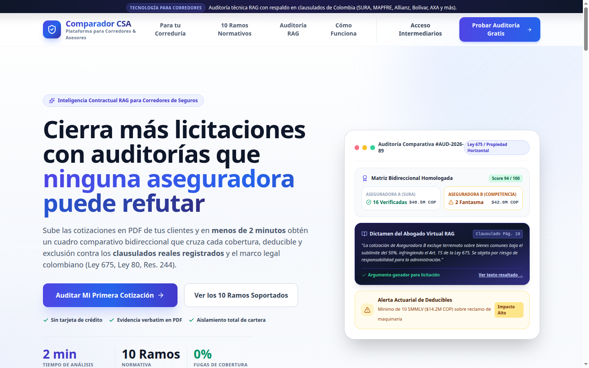

---

## 3.2 Iniciar Sesión (Login)
Formulario de ingreso para usuarios registrados. Requiere correo electrónico y contraseña.

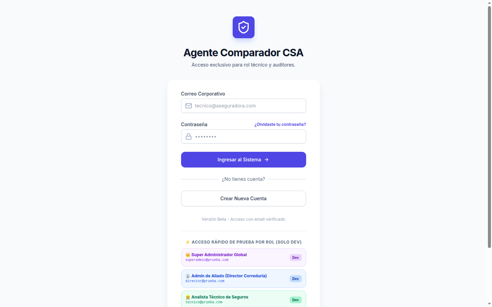

---

## 3.3 Registro de Usuario (Register)
Permite el alta de nuevos asesores o administradores dentro de la corredora.

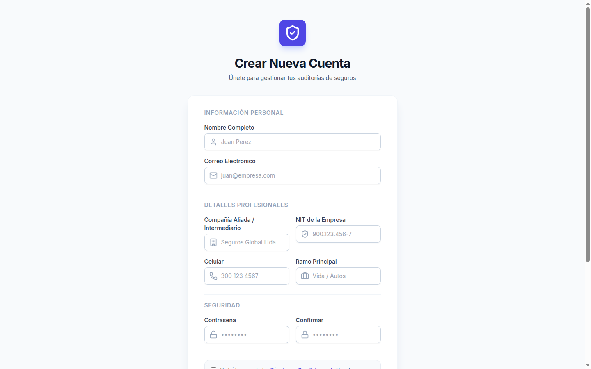

---

## 3.4 Perfil de Usuario y Configuración
Accesible desde la barra superior haciendo clic en el avatar del usuario. Permite actualizar la información del agente y la parametrización de la corredora.

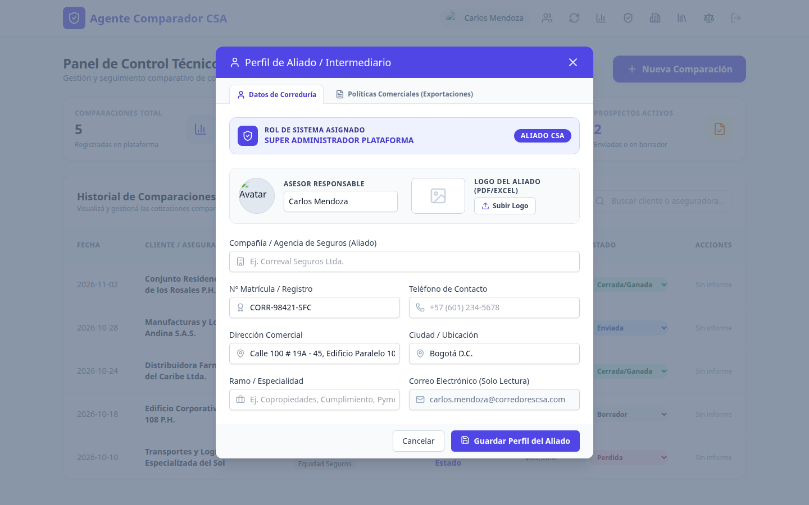

---

# 4. Dashboard Técnico e Historial de Auditorías

El **Dashboard Técnico** es el centro de control de operaciones del asesor. Ofrece métricas de rendimiento comercial y el historial unificado de comparativos realizados.

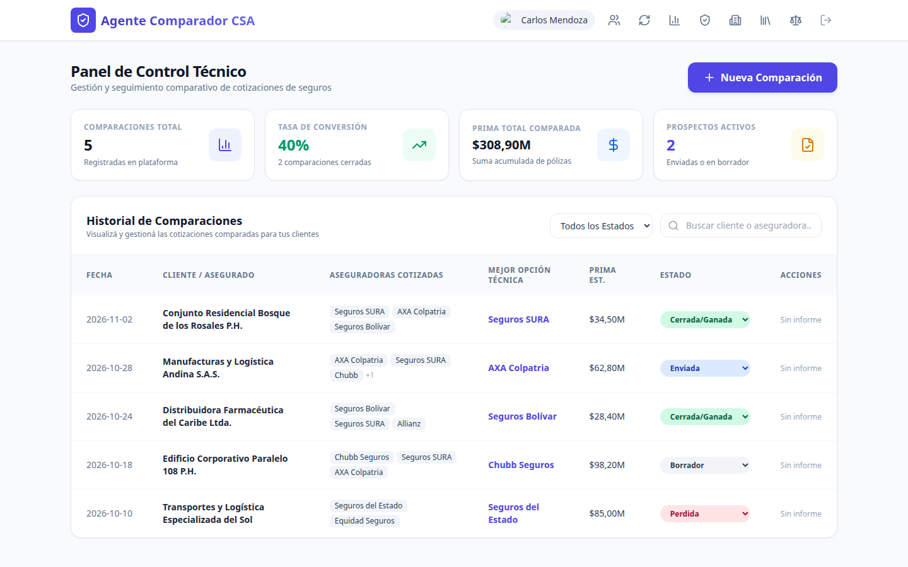

## 4.1 Métricas Clave (KPIs)
- **Total Cotizaciones:** Número total de auditorías procesadas en el periodo.
- **Tasa de Conversión:** Porcentaje de cotizaciones que pasaron a estado *Vendida*.
- **Prima Total Vendida:** Suma acumulada de primas cerradas en moneda local.
- **Prospectos Activos:** Comparativos en estado *Borrador* o *Enviada*.

## 4.2 Tabla de Historial y Filtros
- **Filtros por Estado:** Permite segmentar el historial entre *Borrador*, *Enviada*, *Vendida* y *Perdida*.
- **Buscador:** Filtrado en tiempo real por nombre de cliente o aseguradora.
- **Acciones:**
  - **Ver Reporte:** Reabre el informe comparativo interactivo completo.
  - **Cambiar Estado:** Actualiza el ciclo de vida de la propuesta comercial.

---

# 5. Gestión de Clientes y Copropiedades (Client Manager)

Este módulo gestiona la información técnica y de georreferenciación de los clientes (Empresas PYME, Copropiedades Residenciales o Comerciales).

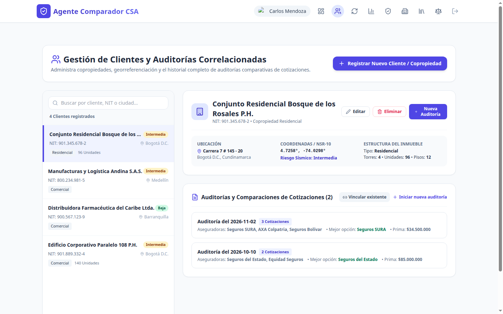

## 5.1 Ficha Técnica del Cliente / Copropiedad
Al registrar o editar un cliente, se capturan variables críticas para la auditoría de riesgos:
- **Datos Básicos:** Razón Social / Nombre del Edificio, NIT, Persona de Contacto, Correo, Teléfono.
- **Geolocalización:** Dirección, Ciudad, Departamento, Latitud y Longitud.
- **Parametrización de Riesgo Físico:**
  - **Zona Sísmica:** *Alta*, *Intermedia* o *Baja*.
  - **Tipo de Edificación:** *Residencial*, *Comercial* o *Mixta*.
  - **Estructura Física:** Número de torres, unidades, pisos, año de construcción.
  - **Equipamiento:** Ascensores y planta eléctrica.

---

# 6. Módulo de Nueva Auditoría (Configuración y Carga de Archivos)

El flujo de creación de auditoría consta de tres pasos principales organizados en una pantalla unificada:

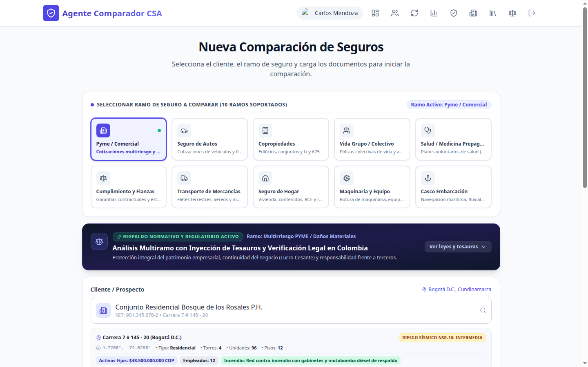

## 6.1 Pasos para Ejecutar una Auditoría
1. **Seleccionar Cliente y Ramo**
2. **Cargar Ofertas / Cotizaciones (Archivos de Entrada)**
3. **Configurar Clausulados Referenciales (Base de Auditoría RAG)**
4. **Iniciar Procesamiento:** Clic en "Analizar Cotizaciones".

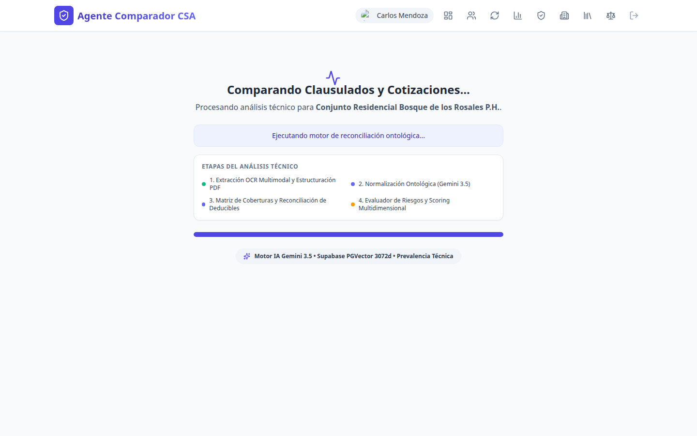

---

# 7. Reporte Comparativo Integral (Comparison Report)

Una vez completado el procesamiento, la plataforma despliega el reporte técnico estructurado en sus componentes clave:

## 7.1 Resumen Ejecutivo y Puntuación Técnica

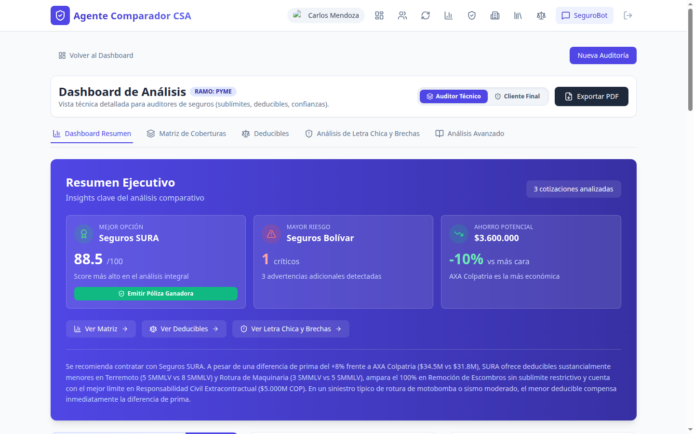

## 7.2 Matriz Unificada de Coberturas (Variable a Variable)

## 7.3 Matriz de Deducibles y Gauges de Riesgo

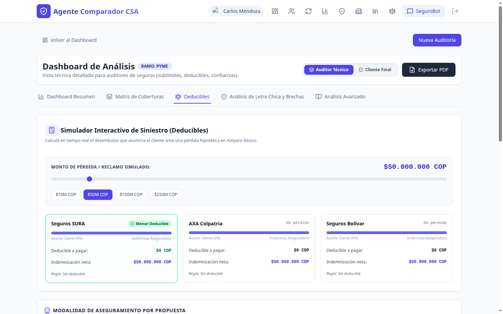

## 7.4 Alertas Contextuales y Coberturas Inversas

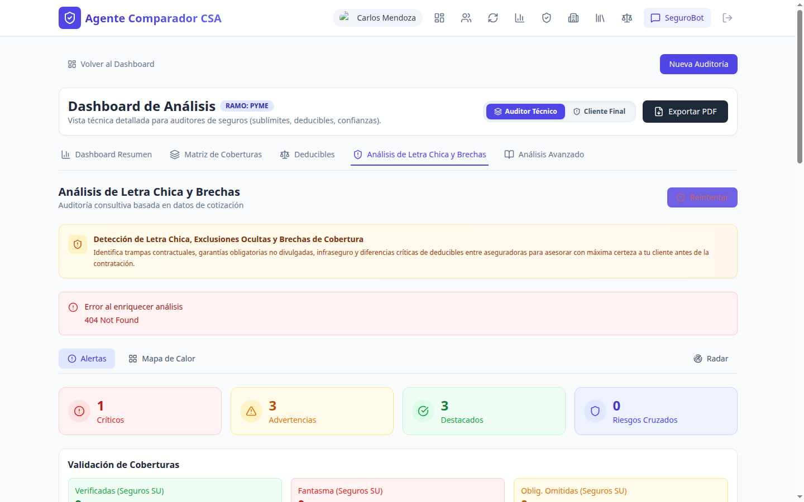

## 7.5 Radar de Aseguradoras y Mapa de Calor de Riesgos

## 7.6 Dictamen Legal y Puntos de Negociación

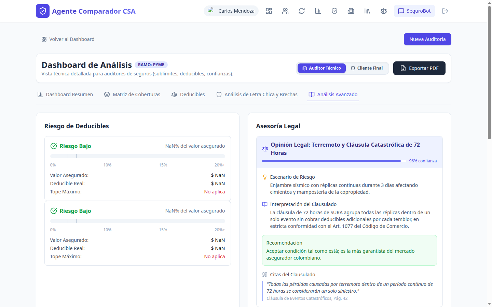

## 7.7 Visor PDF e Inspección de Evidencias

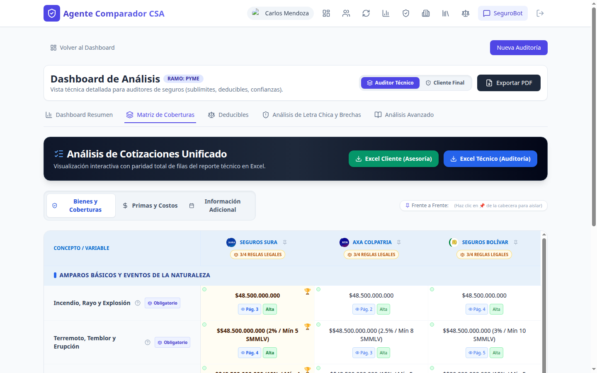

---

# 8. Asistente Virtual Interactivo (SeguroBot - Triple Fuente)

Accesible desde el botón **"SeguroBot"** presente en el reporte comparativo. Es un chat de inteligencia artificial conversacional entrenado para absolver dudas específicas sobre el comparativo actual.

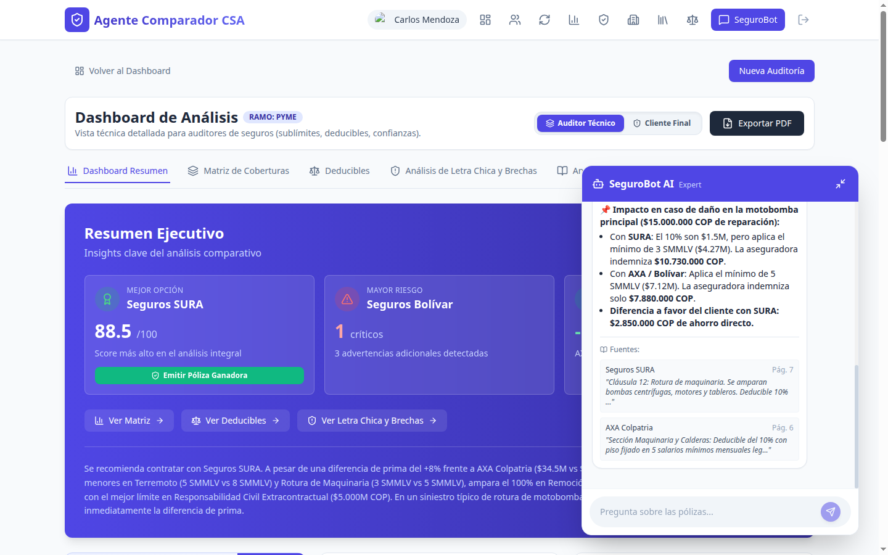

---

# 9. Biblioteca Administrable de Clausulados (Clause Library Admin)

Módulo exclusivo para usuarios con rol `ADMIN`. Permite gestionar los documentos normativos de referencia que utiliza el motor RAG.

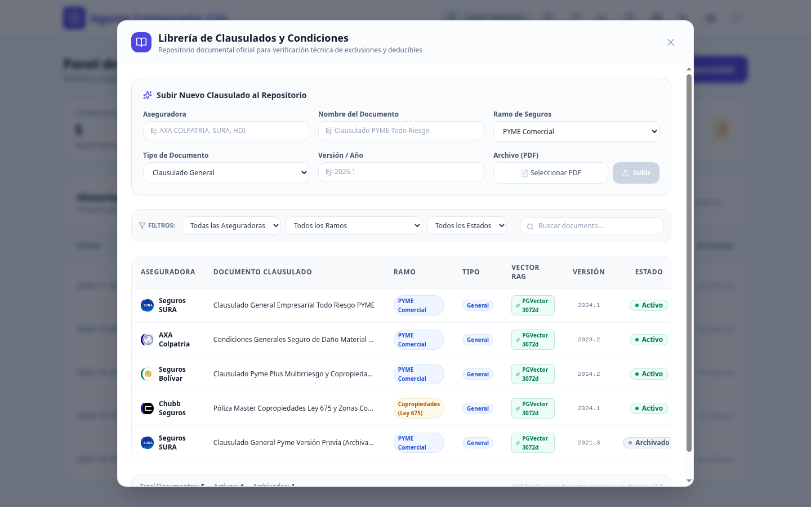

---

# 10. Glosario Técnico y Solución de Problemas

| Problema / Incidencia | Causa Probable | Solución Recomendada |
|---|---|---|
| **El botón "Analizar" permanece deshabilitado.** | No se ha seleccionado un cliente o no se han subido archivos de cotización. | Verifique que haya seleccionado un cliente de la lista y que haya al menos una cotización cargada en el panel izquierdo. |
| **Deducible aparece como "Revisión Manual".** | La redacción del deducible en la cotización es altamente atípica o ilegible. | Use la herramienta de **Corrección Manual** en la matriz para ingresar los valores de porcentaje y SMMLV manualmente. |
| **El chat SeguroBot no responde sobre un amparo.** | El amparo no está en la cotización ni en los clausulados seleccionados. | Cargue el clausulado particular correspondiente en la auditoría o verifique si la cotización omitió dicha sección. |
| **Error al subir un clausulado en la Biblioteca.** | El archivo supera el tamaño máximo permitido o el formato no es PDF válido. | Verifique que el archivo sea un PDF legible y no exceda 50 MB. |

---

*Manual de Usuario - Agente Comparador CSA v2.4*  
*Documento enriquecido con capturas reales de la aplicación y diagramas vectoriales.*
