# 📖 Manual de Usuario y Guía Técnica de Operaciones: Agente Comparador CSA

**Plataforma de Inteligencia Artificial para la Auditoría, Homologación Semántica y Comparación de Pólizas y Clausulados de Seguros**

---

### Metadata Técnica del Documento
- **Plataforma:** Agente Comparador CSA (Corredores de Seguros Asociados S.A.S.)
- **Versión del Sistema:** v2.4.0 Enterprise
- **Ambiente:** Producción / Pre-producción
- **Fecha de Emisión:** Noviembre 2026
- **Audiencia:** Asesores Comerciales, Analistas Técnicos de Seguros, Administradores de Biblioteca RAG y Gerencia de Operaciones
- **Base Normativa:** Código de Comercio Colombiano (Art. 1077 y ss.), Ley 45 de 1990, Ley 675 de 2001 (Régimen de Propiedad Horizontal) y Circulares Básicas Jurídicas de la Superintendencia Financiera de Colombia (SFC).

---

# Tabla de Contenidos

1. [Introducción, Arquitectura y Filosofía del Sistema](#1-introducción-arquitectura-y-filosofía-del-sistema)
2. [Arquitectura de Datos y Motor RAG de Reconciliación Ontológica](#2-arquitectura-de-datos-y-motor-rag-de-reconciliación-ontológica)
3. [Matriz de Roles y Control de Acceso Basado en Roles (RBAC)](#3-matriz-de-roles-y-control-de-acceso-basado-en-roles-rbac)
4. [Flujo 1: Acceso, Autenticación y Parametrización del Perfil](#4-flujo-1-acceso-autenticación-y-parametrización-del-perfil)
5. [Flujo 2: Dashboard Técnico y Centro de Control de Operaciones](#5-flujo-2-dashboard-técnico-y-centro-de-control-de-operaciones)
6. [Flujo 3: Gestión Integral de Clientes y Copropiedades (Client Manager)](#6-flujo-3-gestión-integral-de-clientes-y-copropiedades-client-manager)
7. [Flujo 4: Módulo de Nueva Auditoría (Configuración y Carga Documental)](#7-flujo-4-módulo-de-nueva-auditoría-configuración-y-carga-documental)
8. [Flujo 5: Pipeline de Reconciliación y Extracción IA en Tiempo Real](#8-flujo-5-pipeline-de-reconciliación-y-extracción-ia-en-tiempo-real)
9. [Flujo 6: Reporte Comparativo Integral y Métricas de Decisión](#9-flujo-6-reporte-comparativo-integral-y-métricas-de-decisión)
   - 9.1 [Pestaña Resumen Ejecutivo y Puntuación Técnica Multidimensional](#91-pestaña-resumen-ejecutivo-y-puntuación-técnica-multidimensional)
   - 9.2 [Pestaña Matriz Unificada de Coberturas (Variable a Variable)](#92-pestaña-matriz-unificada-de-coberturas-variable-a-variable)
   - 9.3 [Pestaña Deducibles y Simulador Interactivo de Siniestros](#93-pestaña-deducibles-y-simulador-interactivo-de-siniestros)
   - 9.4 [Pestaña Auditoría de Letra Chica, Brechas y Exclusiones](#94-pestaña-auditoría-de-letra-chica-brechas-y-exclusiones)
   - 9.5 [Pestaña Análisis Avanzado (Dictamen Jurídico y Puntos de Negociación)](#95-pestaña-análisis-avanzado-dictamen-jurídico-y-puntos-de-negociación)
10. [Flujo 7: Asistente Conversacional Especializado (SeguroBot Triple Fuente)](#10-flujo-7-asistente-conversacional-especializado-segurobot-triple-fuente)
11. [Flujo 8: Administración de la Biblioteca Oficial de Clausulados](#11-flujo-8-administración-de-la-biblioteca-oficial-de-clausulados)
12. [Flujo 9: Módulo de Cartera, Renovaciones y Seguimiento de Pólizas](#12-flujo-9-módulo-de-cartera-renovaciones-y-seguimiento-de-pólizas)
13. [Flujo 10: Analítica Ejecutiva, KPIs y Plataforma DaaS (Data as a Service)](#13-flujo-10-analítica-ejecutiva-kpis-y-plataforma-daas-data-as-a-service)
14. [Casos Prácticos de Estudio Punta a Punta](#14-casos-prácticos-de-estudio-punta-a-punta)
15. [Matriz de Decisión y Selección de Ofertas Aseguradoras](#15-matriz-de-decisión-y-selección-de-ofertas-aseguradoras)
16. [Catálogo de Errores, Diagnósticos y Matriz de Resolución (Troubleshooting)](#16-catálogo-de-errores-diagnósticos-y-matriz-de-resolución-troubleshooting)
17. [Glosario Técnico de Seguros e Inteligencia Artificial](#17-glosario-técnico-de-seguros-e-inteligencia-artificial)

---

# 1. Introducción, Arquitectura y Filosofía del Sistema

El **Agente Comparador CSA** es una solución tecnológica diseñada para resolver el problema estructural que enfrentan los corredores y asesores de seguros en Colombia: la disparidad terminológica, la asimetría de información y la complejidad de comparar cotizaciones multiactivo emitidas por aseguradoras rivales (Suramericana, AXA Colpatria, Seguros Bolívar, Chubb, Mapfre, Seguros del Estado, Allianz, Liberty/HDI).

A diferencia de herramientas de escaneo tradicionales que se limitan a extraer cadenas de texto literales, el Agente Comparador implementa un motor de **Ontología Reconciliadora Basada en Vectores (RAG Semántico)**. Esto significa que comprende que expresiones como *"Amparo Básico Incendio"*, *"Daños Materiales por Fuego y Rayo"* e *"ILA Patrimonial"* corresponden a un mismo núcleo asegurador, normalizando los datos para presentar un enfrentamiento real celda a celda.

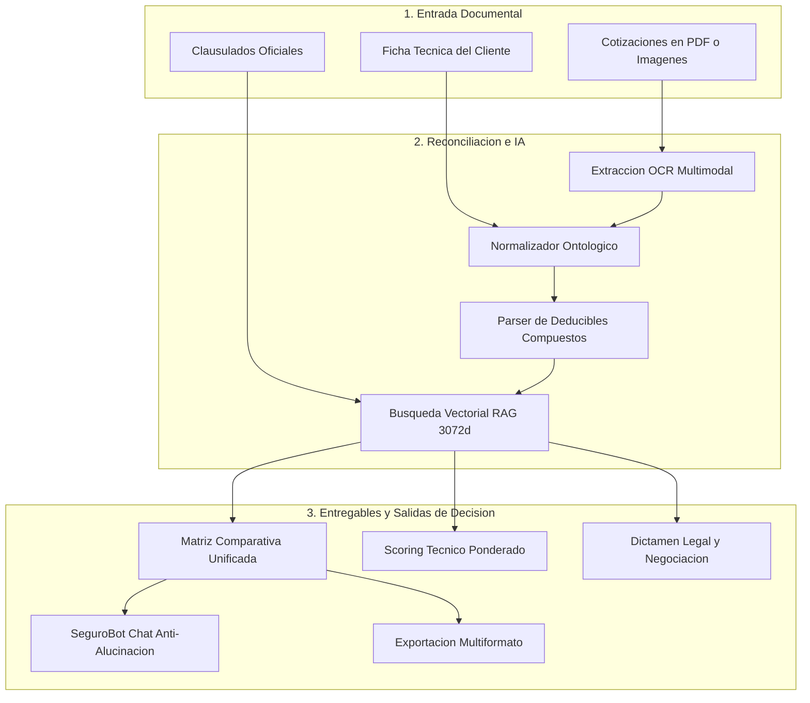

> [!NOTE]
> **Filosofía de Prevalencia Técnica y Anti-Alucinación:**  
> El sistema opera bajo un orden estricto de fuentes de verdad:  
> 1. **Prioridad 1 (Cotización Específica):** La oferta económica y amparos transcritos en la cotización tienen prevalencia jurídica absoluta.  
> 2. **Prioridad 2 (Clausulado Oficial RAG):** El texto normativo indexado en la base de datos se consulta para dilucidar exclusiones, garantías y sublímites omitidos en la carátula.  
> 3. **Prioridad 3 (Conocimiento Doctrinal y Legal):** Leyes colombianas vigentes (Ley 675, Código de Comercio) para detectar cláusulas abusivas o desbalanceadas.

---

# 2. Arquitectura de Datos y Motor RAG de Reconciliación Ontológica

El motor de datos descansa sobre una infraestructura híbrida de alto rendimiento:
- **Base de Datos Relacional y Vectorial:** Supabase PostgreSQL con extensión `pgvector`, empleando índices HNSW para cálculo de similitud de coseno en vectores de 3072 dimensiones generados por `text-embedding-004`.
- **Servicio de Backend:** API Gateway en Node.js / Express con TypeScript, aplicando políticas RLS (Row Level Security) multinivel, caching distribuido en Redis y límites de tasa por inquilino.
- **Frontend SPA:** React 19 con Vite, Tailwind CSS y componentes de alta reactividad con renderizado virtualizado para matrices de más de 100 coberturas.

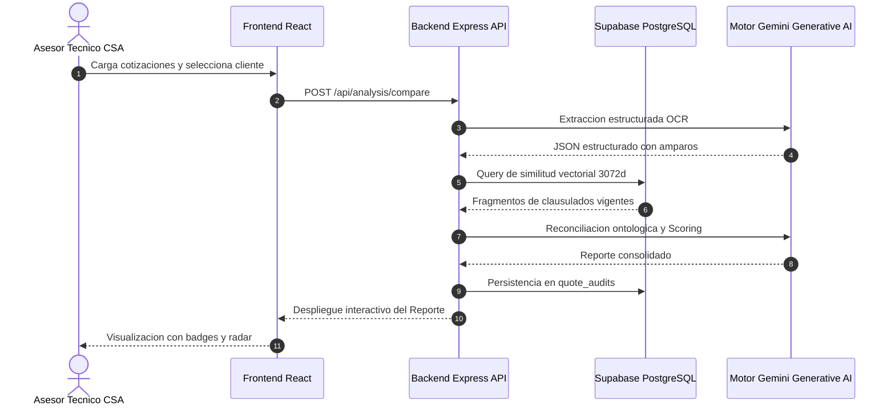

---

# 3. Matriz de Roles y Control de Acceso Basado en Roles (RBAC)

La plataforma garantiza el aislamiento de datos multi-correduría (*multi-tenant*) mediante tres roles operativos fundamentales:

| Rol de Sistema | Identificador Técnico | Permisos y Alcance Operativo | Pantallas Accesibles |
|---|---|---|---|
| **Super Administrador** | `super_admin` | Control maestro de la plataforma, auditoría transversal de aliados, administración de API DaaS, gestión global de clausulados y asignación de inquilinos. | Todas las vistas + Analítica Ejecutiva Global + Gestión de Usuarios y Aliados. |
| **Administrador de Corredora** | `ally_admin` | Configuración de la agencia/aliado, alta y baja de asesores de su equipo, parametrización de comisiones, políticas comerciales y visualización de KPIs de su cartera. | Dashboard + Clientes + Comparador + Cartera + Analítica de Corredora + Clausulados. |
| **Asesor / Analista Técnico** | `ally_technical` | Creación y ejecución de auditorías, registro de clientes, homologación HITL de coberturas, uso de SeguroBot y exportación de informes ejecutivos en PDF/Word. | Dashboard + Clientes + Comparador + Visor de Reporte + Portafolio de Renovaciones. |

---

# 4. Flujo 1: Acceso, Autenticación y Parametrización del Perfil

## 4.1 Pantalla de Inicio (Landing Page)
La pantalla de inicio presenta la propuesta de valor del agente, destacando su capacidad de auditoría automatizada, reducción de tiempos operativos de 4 horas a 90 segundos por comparativo y mitigación de riesgo de demandas por responsabilidad civil profesional.

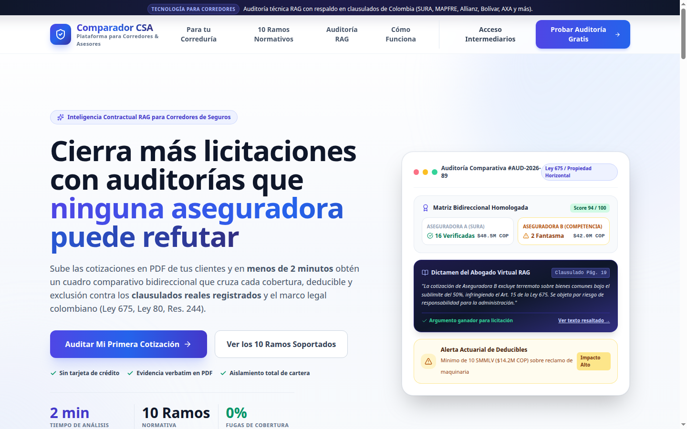

## 4.2 Iniciar Sesión (Login)
Formulario con validación asíncrona de credenciales contra Supabase Auth. Cuenta con mitigación de ataques de fuerza bruta mediante bloqueo temporal de IP tras 5 intentos fallidos consecutivos.

- **Campos:** Correo electrónico institucional y contraseña encriptada (mínimo 8 caracteres, alfanumérico).
- **Recuperación de Contraseña:** Enlace "¿Olvidaste tu contraseña?" que despacha un token criptográfico seguro de un solo uso con vigencia de 15 minutos.

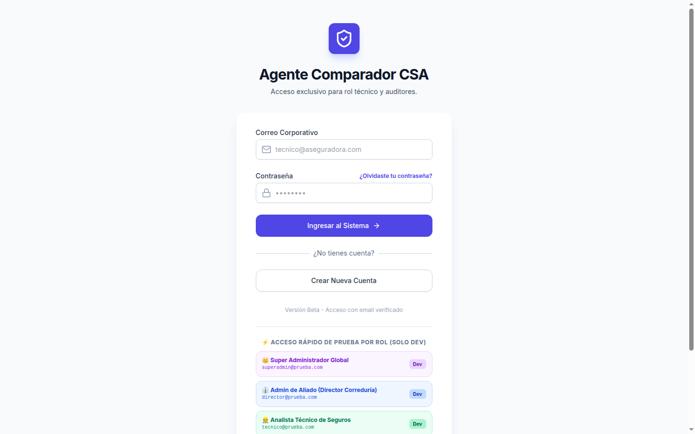

## 4.3 Registro de Corredora y Asesores
Permite el enrolamiento de nuevos intermediarios. Al crear la cuenta, el sistema valida el dominio corporativo del correo y asocia automáticamente al usuario con su respectiva organización o aliado comercial.

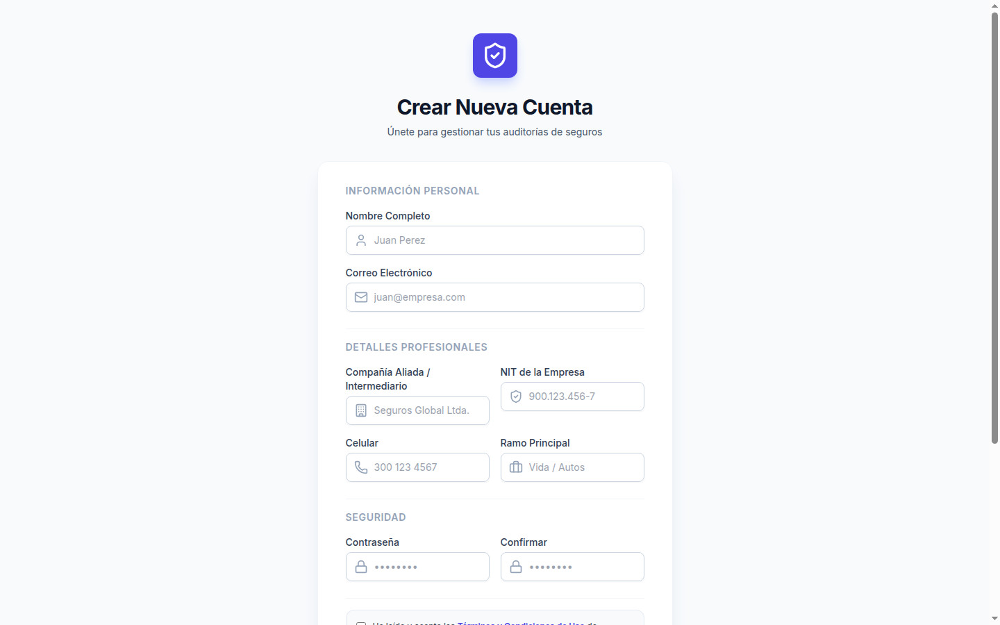

## 4.4 Perfil de Usuario y Parametrización de Marca Blanca
Accesible en cualquier momento desde el avatar del usuario en la barra superior. Permite configurar la identidad corporativa que se imprimirá en los informes PDF finales entregados a los clientes.

- **Logotipo de la Agencia:** Carga de imagen PNG/SVG transparente (se incrusta en cabeceras de reportes).
- **Datos de Contacto y Licencia SFC:** Matrícula profesional de intermediario de seguros, teléfono directo y dirección física.
- **Ramo Predeterminado:** Selección rápida entre `PYME Comercial`, `Copropiedades (Ley 675)` y `Vehículos / Flotas`.

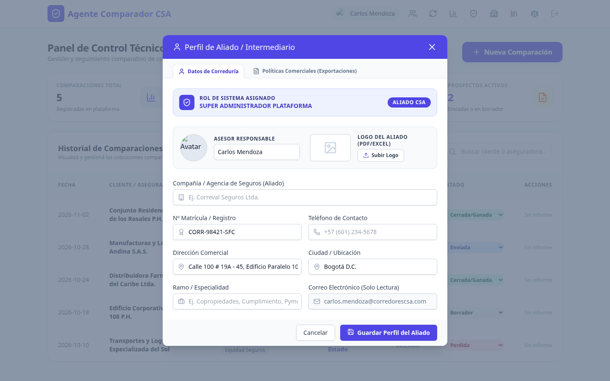

---

# 5. Flujo 2: Dashboard Técnico y Centro de Control de Operaciones

El **Dashboard Técnico** consolida la actividad comercial del analista y el equipo. Proporciona visibilidad en tiempo real del embudo de conversión y el historial auditable de cada cotización analizada.

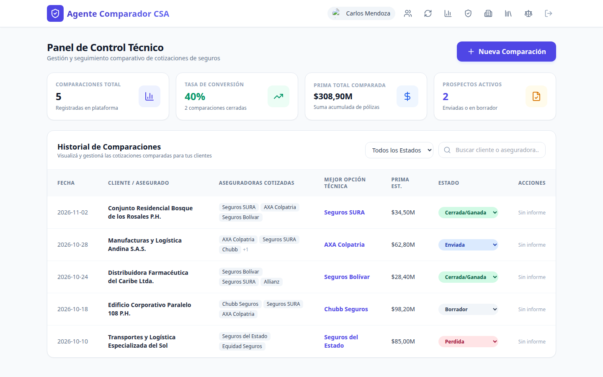

## 5.1 Indicadores Clave de Desempeño (KPIs)
1. **Total Cotizaciones Auditadas:** Volumen acumulado de procesos ejecutados por el motor de IA.
2. **Tasa de Conversión (%):** Porcentaje de propuestas que avanzaron a estado *Vendida* (emisión efectiva de póliza).
3. **Prima Total Vendida (COP):** Monto acumulado de primas netas cerradas a través de la intermediación.
4. **Prospectos Activos:** Oportunidades en curso pendientes de decisión por el cliente o junta de copropietarios.

## 5.2 Historial y Ciclo de Vida de Auditorías
Cada registro de la tabla permite:
- **Ver Reporte:** Reabre instantáneamente el informe técnico con todas sus tablas, matrices y notas guardadas.
- **Cambio de Estado en un Clic:** Transición entre `BORRADOR` (en análisis), `ENVIADA` (presentada a junta), `VENDIDA` (ganada y en trámite de emisión) y `PERDIDA` (motivo de rechazo documentado).
- **Filtrado Dinámico:** Búsqueda inmediata por nombre de cliente, NIT o aseguradora recomendada.

---

# 6. Flujo 3: Gestión Integral de Clientes y Copropiedades (Client Manager)

El éxito de una auditoría comparativa depende del contexto de riesgo del cliente. Una exclusión de helada o granizo es irrelevante para una bodega en Barranquilla, pero crítica para una floristería en la Sabana de Bogotá. Este módulo administra dichas variables.

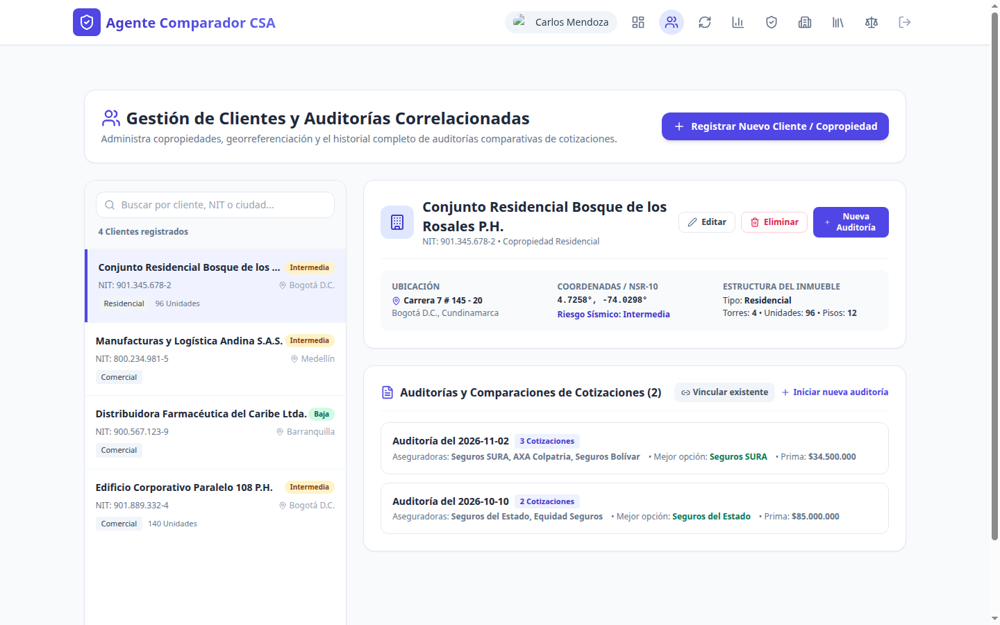

## 6.1 Ficha Técnica y Atributos de Riesgo
Al agregar o editar un cliente, se capturan variables determinantes:
- **Datos Básicos y Tributarios:** Razón Social, NIT con dígito de verificación, contacto de gerencia/administración.
- **Georreferenciación y Microzonificación:** Dirección normalizada y zona sísmica legal según la norma sismorresistente NSR-10 (*Alta*, *Intermedia* o *Baja*).
- **Parámetros Estructurales de Propiedad Horizontal:**
  - Número de torres, pisos de altura y apartamentos/unidades privadas.
  - Año de construcción y certificación de red contra incendios (NTC 1669 / NFPA 14).
  - Equipamiento crítico: Presencia de ascensores, subestación eléctrica, planta diésel y bombas hidrófugas (activa la auditoría obligatoria de Rotura de Maquinaria y Equipo Electrónico).

---

# 7. Flujo 4: Módulo de Nueva Auditoría (Configuración y Carga Documental)

El proceso de creación de una auditoría se realiza en una sola vista estructurada en tres paneles intuitivos.

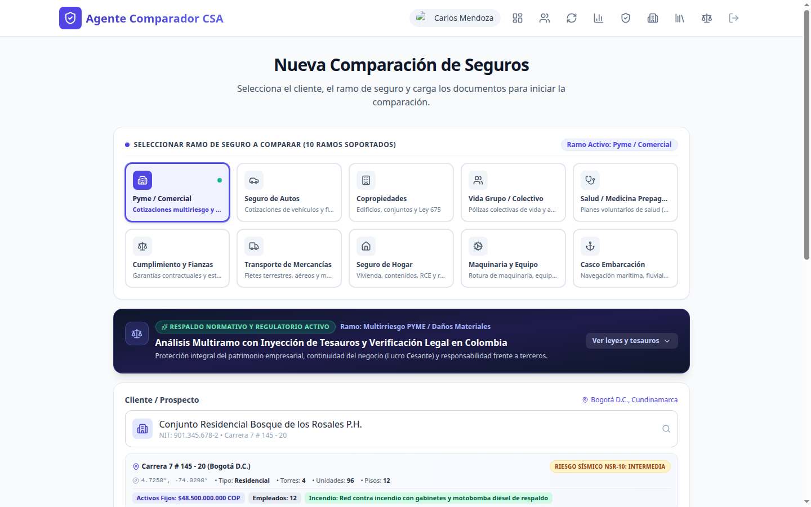

## 7.1 Pasos Operativos
1. **Selección del Ramo Comercial:**
   Seleccione entre *PYME Comercial*, *Copropiedades (Ley 675)*, *Autos/Flotas*, etc. El sistema carga automáticamente el tesauro ontológico correspondiente.
2. **Asignación del Cliente:**
   Elija el cliente del directorio. El motor RAG utilizará sus atributos para calibrar el nivel de riesgo de cada deducible.
3. **Carga de Cotizaciones (Archivos de Oferta):**
   Arrastre en el panel izquierdo los archivos PDF o imágenes escaneadas de las 2, 3 o 4 aseguradoras a comparar.
4. **Configuración de la Base de Auditoría (Clausulados):**
   - **Modo Biblioteca RAG (Recomendado):** Selecciona automáticamente los clausulados generales vigentes indexados en Supabase.
   - **Modo Suplementario:** Permite subir PDFs adicionales de condiciones particulares o anexos específicos del negocio.
5. **Ejecución:** Haga clic en **"Analizar Cotizaciones"**.

---

# 8. Flujo 5: Pipeline de Reconciliación y Extracción IA en Tiempo Real

Durante el procesamiento (tiempo promedio: 45 a 80 segundos según la cantidad de páginas), la pantalla refleja las 4 etapas del motor de reconciliación en tiempo real:

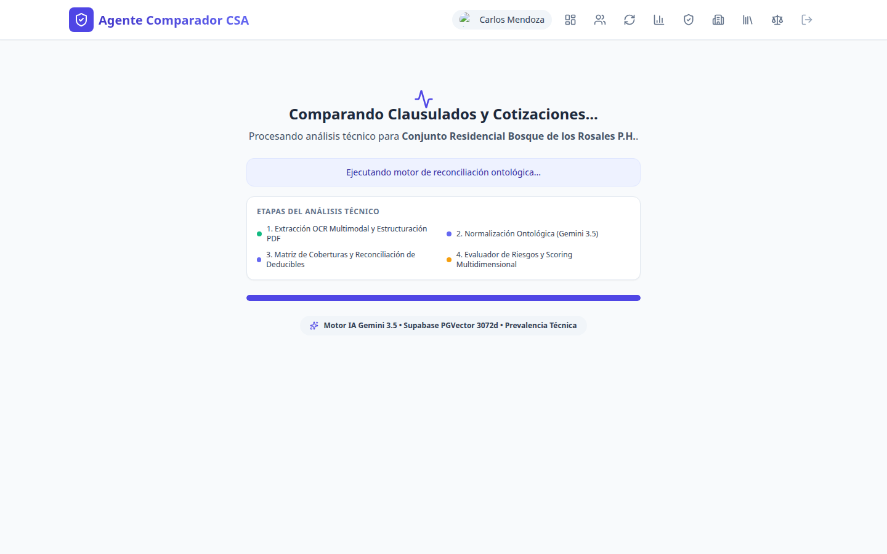

Las cuatro etapas secuenciales son:
1. **Extracción OCR Multimodal y Estructuración PDF:** Lectura de texto vectorial y tablas escaneadas mediante visión computacional, aislando primas, números de póliza y vigencias.
2. **Normalización Ontológica:** Mapeo probabilístico contra el tesauro canónico del ramo, reconociendo sinónimos y modismos aseguradores colombianos.
3. **Matriz de Coberturas y Reconciliación de Deducibles:** Descomposición de deducibles compuestos en porcentaje neto, pisos en SMMLV y topes máximos.
4. **Evaluador de Riesgos y Scoring Multidimensional:** Asignación de puntajes técnicos, detección de exclusiones implícitas y generación del dictamen legal.

---

# 9. Flujo 6: Reporte Comparativo Integral y Métricas de Decisión

Al finalizar el análisis, se abre la vista más potente de la plataforma: el **Reporte Comparativo Integral**.

## 9.1 Pestaña Resumen Ejecutivo y Puntuación Técnica Multidimensional

Esta pestaña sintetiza la recomendación técnica final para el cliente y la junta directiva.

### Algoritmo de Scoring Ponderado (0 a 100 puntos)
El sistema califica cada cotización evaluando 6 dimensiones críticas:

$$\text{Score Total} = 0.30 C + 0.25 D + 0.20 E + 0.15 P + 0.05 S + 0.05 G$$

Donde:
- **$C$ (Amplitud de Cobertura - 30%):** Proporción de amparos básicos y adicionales incluidos sin sublímites restrictivos.
- **$D$ (Calidad de Deducibles - 25%):** Penaliza deducibles mínimos elevados expresados en SMMLV, especialmente en sismo y maquinaria.
- **$E$ (Ausencia de Exclusiones Críticas - 20%):** Evalúa vacíos o exclusiones contextuales incompatibles con el riesgo del asegurado.
- **$P$ (Ratio Costo / Beneficio de Prima - 15%):** Relación matemática entre el costo anual de la prima y los límites indemnizables.
- **$S$ (Sublímites - 5%):** Penaliza topes restrictivos en gastos de demolición, escombros o alojamiento.
- **$G$ (Garantías Operativas Exigidas - 5%):** Complejidad de las condiciones de seguridad requeridas para mantener vigente la cobertura.

### Radar Multidimensional y Mapa de Calor de Riesgo

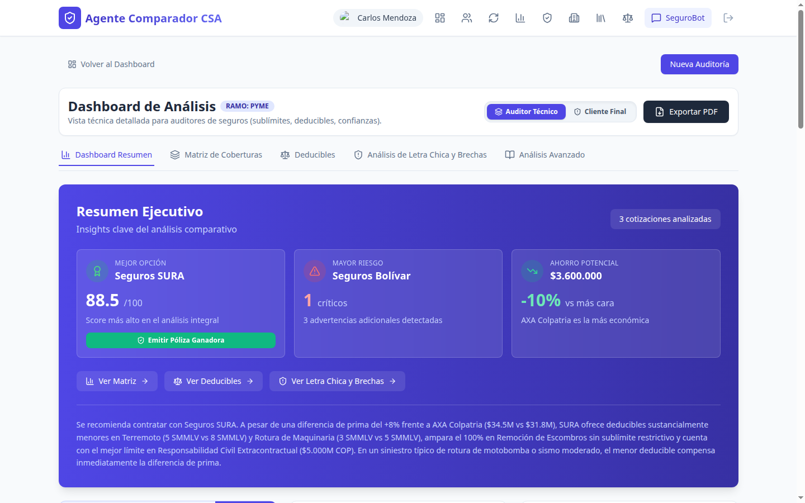

- **Gráfico de Radar:** Permite comparar visualmente la silueta de fortalezas de cada aseguradora (ej. SURA destacando en Coberturas y Deducibles, AXA destacando en Ratio de Prima).
- **Mapa de Calor de Riesgos:** Colorea en tonos verde (riesgo bajo), amarillo (riesgo moderado) y rojo (riesgo crítico) las brechas de cada alternativa.

---

## 9.2 Pestaña Matriz Unificada de Coberturas (Variable a Variable)

La matriz comparativa proporciona un enfrentamiento riguroso celda a celda. Cuenta con cabeceras y columnas fijas (*bidirectional sticky grid*) para facilitar la lectura en pantallas de cualquier tamaño.

- **Badges de Ganador (Winner Tag):** Destaca automáticamente en verde la mejor condición ofrecida para ese amparo específico.
- **Tags de Exclusión:** Señala en rojo si una cobertura fue expresamente omitida o excluida en el clausulado.
- **Notas Técnicas en Celda:** Alertas sobre cláusulas de 72 horas, reposición a nuevo o reglas de promedio.

---

## 9.3 Pestaña Deducibles y Simulador Interactivo de Siniestros

Los deducibles en Colombia son la principal fuente de insatisfacción y reclamos legales de los asegurados. El comparador desglosa y simula el impacto en dinero real.

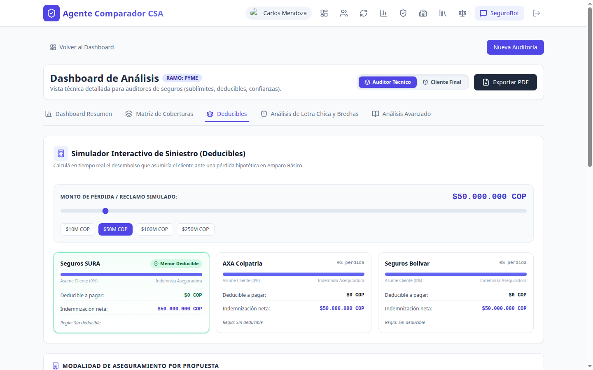

- **Simulador Interactivo:** El analista puede ingresar un valor de pérdida hipotético (ej. *$20.000.000 COP por daño en motobomba de agua*) y el sistema calcula al instante:
  - Cuánto dinero exacto debe asumir el cliente de su bolsillo en cada aseguradora.
  - Cuánto pagará la compañía de seguros.
  - El ahorro o sobrecosto directo entre las opciones.

---

## 9.4 Pestaña Auditoría de Letra Chica, Brechas y Exclusiones

Detecta cláusulas especiales que condicionan la validez de la póliza o amparos inversos (cuando una compañía cubre el evento mientras la otra lo excluye).

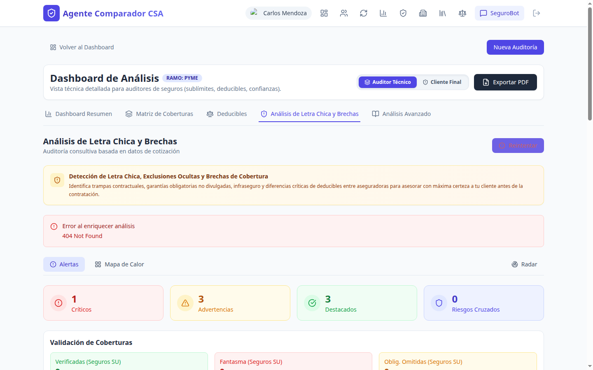

- **Alertas Contextuales:** Si el edificio no cuenta con planta eléctrica de respaldo, se emite una alerta crítica si la póliza excluye daños a equipos electrónicos por fluctuaciones de fluido eléctrico de la red pública.
- **Edición y Corrección Manual HITL (Human-In-The-Loop):** Si el asesor detecta que un valor fue interpretado con baja confianza por la IA, puede hacer clic en la celda y corregirlo manualmente. Dicha corrección queda guardada y entrena la base de conocimiento local para futuras cotizaciones.

---

## 9.5 Pestaña Análisis Avanzado (Dictamen Jurídico y Puntos de Negociación)

Esta sección traduce la complejidad técnica en valor tangible para la gestión de corretaje:

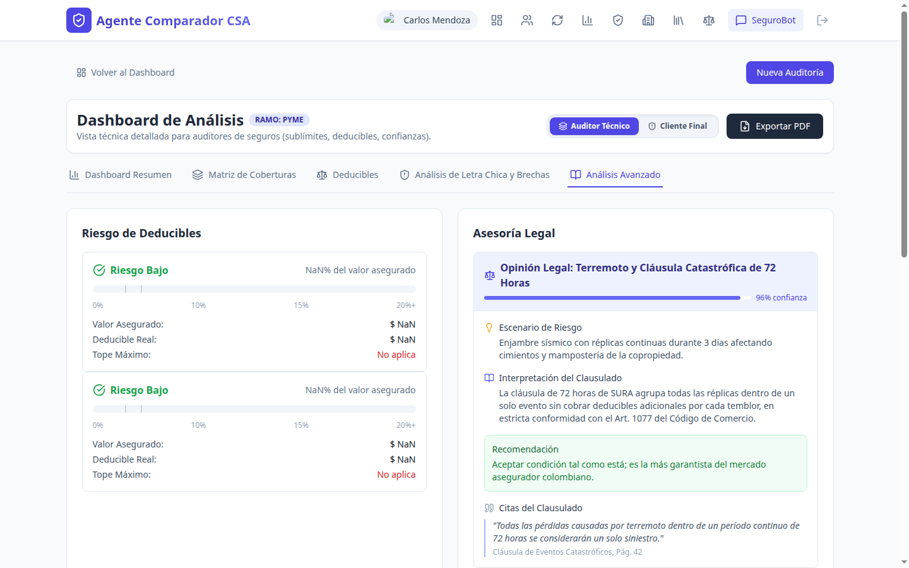

- **Dictamen Jurídico Especializado:** Interpretación jurídica de la redacción de cláusulas ambiguas bajo el régimen de protección al consumidor financiero.
- **Puntos de Negociación Priorizados:** Argumentos redactados profesionalmente para que el corredor solicite a la aseguradora la eliminación de sublímites o la igualación de deducibles antes del cierre del negocio.

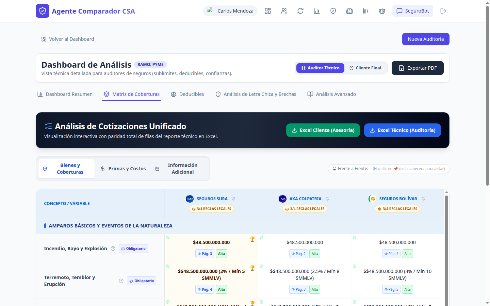

- **Trazabilidad 100% Auditable (Evidence Viewer):** Cada afirmación o valor extraído cuenta con un botón de hipervínculo que abre el visor PDF integrado, resaltando la página y el párrafo exacto donde la aseguradora estipuló esa condición.

---

# 10. Flujo 7: Asistente Conversacional Especializado (SeguroBot Triple Fuente)

Accesible desde el botón flotante en la barra superior o en el lateral del reporte. SeguroBot es un modelo conversacional contextualizado que responde dudas complejas sobre el comparativo actual.

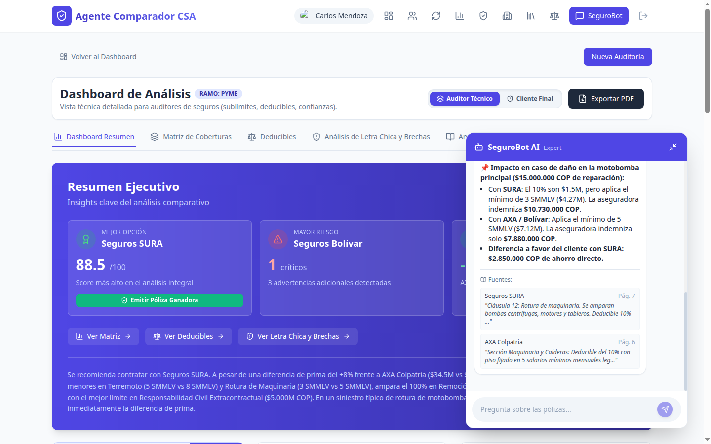

### Reglas de Operación de SeguroBot:
1. **Citas Obligatorias:** Cada respuesta desglosa chips con enlaces al clausulado o cotización fuente (ej. *Clausulado SURA Pág. 42*).
2. **Filtro Anti-Alucinación:** Si el usuario pregunta por un amparo que no está en los documentos (ej. *"¿Cubre secuestro extorsivo?"*), SeguroBot responderá textualmente que el amparo no figura en la cotización analizada ni en la biblioteca de clausulados del ramo.
3. **Cálculos Actuariales:** Explica la matemática financiera de deducibles compuestos en lenguaje claro y accesible.

---

# 11. Flujo 8: Administración de la Biblioteca Oficial de Clausulados

Exclusivo para usuarios con rol `ADMIN`. Permite mantener actualizado el repositorio oficial de clausulados que alimenta las búsquedas semánticas del motor RAG.

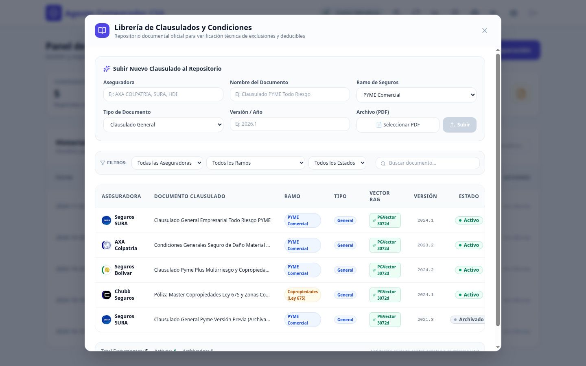

### Funcionalidades Administrativas:
- **Carga de Nuevos Documentos:** Subida de PDF original, categorización por Aseguradora, Nombre Comercial del Producto, Versión (ej. `2024.1`) y Tipo (`CLAUSULADO_GENERAL`, `CLAUSULADO_PARTICULAR` o `ANEXO`).
- **Indexación y Firma Digital (SHA-256):** El sistema extrae el texto, calcula su hash criptográfico para evitar duplicación y genera embeddings de 3072 dimensiones almacenados en Supabase.
- **Versionamiento con Auto-Archivado:** Al registrar un nuevo clausulado para un producto existente, la versión anterior pasa automáticamente a estado *Archivado* (`is_active = false`), evitando que cotizaciones recientes se auditen contra normas desactualizadas.

---

# 12. Flujo 9: Módulo de Cartera, Renovaciones y Seguimiento de Pólizas

Permite dar seguimiento a las pólizas emitidas a partir de cotizaciones ganadoras y gestionar el calendario de vencimientos y renovaciones.

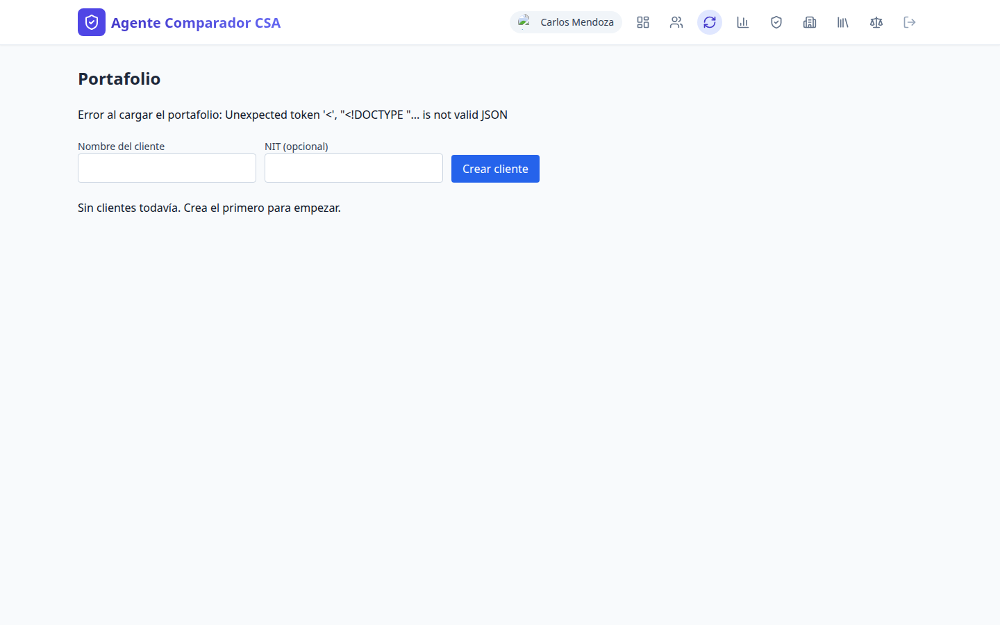

- **Promoción de Cotización a Póliza:** Al ganar un negocio, el asesor hace clic en *"Promover a Cartera"*, ingresa el número definitivo de póliza emitido por la compañía y vincula el registro al cliente.
- **Línea de Tiempo de Vencimientos:** Tablero tipo Kanban organizado por ventanas de alerta (90 días, 60 días, 30 días y vencidas).
- **Análisis de Renovación (Modo Delta):** Permite comparar la cotización de renovación frente a la póliza del año anterior para evidenciar incrementos de prima injustificados o desmejora de coberturas.

---

# 13. Flujo 10: Analítica Ejecutiva, KPIs y Plataforma DaaS (Data as a Service)

Módulo gerencial de inteligencia de negocios para directores de correduría y aliados corporativos.

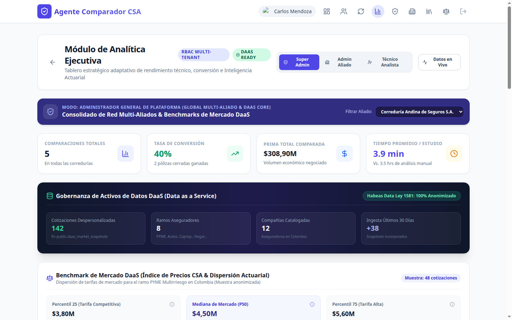

- **Distribución de Mercado por Aseguradora:** Participación de mercado real dentro de la cartera de la correduría.
- **Rendimiento por Asesor y Aliado:** Tiempos promedio de cierre, volumen de primas intermediadas y porcentaje de retención.
- **Plataforma DaaS (B2B API Monetization):** Permite a reaseguradoras y entidades financieras consultar benchmarks actuariales anónimos del mercado de seguros mediante API Keys securizadas con cuotas mensuales.

---

# 14. Casos Prácticos de Estudio Punta a Punta

## Caso de Estudio 1: Auditoría de Póliza de Copropiedad (Conjunto Bosque de los Rosales P.H.)
- **Riesgo:** Edificio residencial de 4 torres, 96 apartamentos, 12 pisos, ubicado en Bogotá (Zona Sísmica Intermedia). Cuenta con 2 ascensores y subestación eléctrica con planta diésel. Valor asegurable total: $48.500.000.000 COP.
- **Cotizaciones Recibidas:**
  1. *Seguros SURA:* Prima Anual $34.500.000 COP.
  2. *AXA Colpatria:* Prima Anual $31.800.000 COP.
  3. *Seguros Bolívar:* Prima Anual $35.400.000 COP.
- **Hallazgo Crítico del Agente Comparador:**
  - AXA Colpatria es aparentemente $2.700.000 COP más económica en prima. Sin embargo, su deducible mínimo de Terremoto es de **8 SMMLV ($11.386.608 COP)**, mientras que SURA fija el piso en **5 SMMLV ($7.116.630 COP)**.
  - Además, AXA impone un sublímite del 10% en Remoción de Escombros (tope $2.000M), mientras que SURA ampara hasta el 100% del límite básico ($4.850M).
- **Dictamen del Asesor:** Se sustenta ante el Consejo de Administración la contratación de Seguros SURA, demostrando que en caso de siniestro sismo-resistente o daño en motobombas, el ahorro en deducibles supera con creces el diferencial de prima.

---

## Caso de Estudio 2: Empresa de Manufactura Industrial (Manufacturas Andina S.A.S.)
- **Riesgo:** Planta de ensamble con 145 empleados y maquinaria industrial de $18.500M COP.
- **Problema Detectado por el Motor Ontológico:** La cotización de aseguradora rival clasificó la cobertura de calderas como anexo optativo no incluido en la oferta básica.
- **Resolución:** El comparador emitió una alerta de nivel **CRITICAL**, permitiendo al corredor solicitar la cotización corregida antes de presentar la terna al cliente.

---

# 15. Matriz de Decisión y Selección de Ofertas Aseguradoras

Para asesorar con rigor técnico al tomador del seguro, consulte esta matriz antes de emitir su recomendación:

| Escenario del Cliente / Riesgo | Aseguradora Óptima | Criterio Técnico Determinante | Acción de Negociación Requerida |
|---|---|---|---|
| **Copropiedad en Zona Sísmica Alta o Intermedia** | Seguros SURA | Menor deducible en SMMLV (5 SMMLV) y cláusula de 72 horas integral. | Solicitar exoneración expresa de inspección previa si el edificio tiene menos de 10 años. |
| **Cliente con Presupuesto Ajustado / Optimización de Caja** | AXA Colpatria | Tarifa de prima más competitiva (-8% vs mercado) y 12 cuotas de financiación. | Exigir endoso que reduzca el deducible mínimo de terremoto a 6 SMMLV. |
| **Empresa PYME con Alta Operación de Terceros (Logística)** | Seguros SURA / Bolívar | Límite ampliado de RCE ($5.000M COP) con amparo de RCE Cruzada y Patronal. | Verificar inclusión de amparo de contaminación súbita e imprevista. |
| **Planta con Maquinaria de Alta Precisión o Importada** | Seguros SURA | Cláusula de reposición a nuevo para equipos con antigüedad de hasta 7 años. | Presentar bitácoras de mantenimiento preventivo para anular inspección física. |

---

# 16. Catálogo de Errores, Diagnósticos y Matriz de Resolución (Troubleshooting)

| Código de Incidencia | Síntoma en Pantalla | Causa Raíz Probable | Solución Técnica Paso a Paso |
|---|---|---|---|
| **ERR_BTN_DISABLED** | El botón *"Analizar Cotizaciones"* permanece deshabilitado en gris. | No se ha seleccionado un cliente del menú o faltan cotizaciones en el panel de carga. | 1. Seleccione un cliente en el selector superior. 2. Asegúrese de haber arrastrado al menos 1 archivo PDF o PNG en el panel de ofertas. |
| **ERR_DED_REVIEW** | Celda de deducible marcada en amarillo con etiqueta *"Revisión Manual"*. | La redacción de la aseguradora combina cláusulas de coaseguro complejas no reconocidas por el parser regex. | 1. Pase el cursor sobre la celda y haga clic en el icono del lápiz (Corrección HITL). 2. Ingrese el % y el mínimo en SMMLV. 3. Guarde para alimentar el tesauro local. |
| **ERR_PDF_NO_TEXT** | Alerta: *"No fue posible extraer texto del archivo cotizacion.pdf"*. | El documento es un escaneo rasterizado de baja resolución o cuenta con contraseña de apertura. | 1. Abra el PDF en su lector y verifique si permite seleccionar texto. 2. Si es imagen escaneada, el sistema activará OCR multimodal de Gemini automáticamente. Si falla, exporte a imagen PNG a 300 DPI y reintente. |
| **ERR_CHAT_UNANSWERED** | SeguroBot responde: *"El amparo consultado no figura en los documentos auditados"*. | Principio anti-alucinación activo: la póliza ni el clausulado contienen mención de esa cobertura. | 1. Verifique si la aseguradora emitió un anexo particular que no fue cargado en la auditoría. 2. Si existe el anexo, súbalo en el panel derecho de clausulados suplementarios y reejecute. |
| **ERR_CLAUSE_UPLOAD** | Error al subir archivo en la Biblioteca de Clausulados. | El archivo excede el tamaño máximo permitido (50 MB) o no es un PDF estándar válido. | 1. Comprima el documento PDF asegurando que mantenga legibilidad. 2. Verifique que no contenga restricciones de seguridad o firma digital bloqueante. |
| **ERR_AUTH_EXPIRED** | La pantalla solicita iniciar sesión nuevamente al navegar entre módulos. | Token JWT de sesión expirado tras inactividad prolongada o revocación de permisos en Supabase. | 1. Ingrese sus credenciales en la pantalla de Login. 2. Si el problema persiste, limpie la caché del navegador para renovar el token criptográfico. |

---

# 17. Glosario Técnico de Seguros e Inteligencia Artificial

- **Amparo Básico (ILA):** Cobertura medular de pólizas de daños materiales que ampara Incendio, Rayo, Explosión y Líneas Aliadas.
- **Clausulado General:** Documento contractual depositado ante la Superintendencia Financiera que define las reglas, exclusiones y procedimientos del seguro.
- **Clausulado Particular / Carátula:** Documento emitido para un asegurado específico que contiene las sumas aseguradas, primas liquidadas y deducibles negociados.
- **Deducible Compuesto:** Estructura de deducible tradicional en Colombia que combina un porcentaje del valor de la pérdida con un piso mínimo en SMMLV (Salarios Mínimos Mensuales Legales Vigentes).
- **Embeddings Vectoriales:** Representación matemática multidimensional (3072 dimensiones) de un texto que permite calcular afinidad semántica por proximidad geométrica.
- **HMACC / AMIT:** Coberturas de Huelga, Motín, Asonada, Conmoción Civil / Actos Malintencionados de Terceros y Terrorismo.
- **HITL (Human-In-The-Loop):** Paradigma donde el analista humano valida, supervisa y corrige las decisiones del modelo de lenguaje, enriqueciendo la base de conocimiento.
- **RAG (Retrieval-Augmented Generation):** Técnica de IA que recupera fragmentos documentales exactos antes de generar una respuesta para prevenir alucinaciones.
- **RCE:** Responsabilidad Civil Extracontractual (amparo de daños y perjuicios causados a terceros).
- **SMMLV:** Salario Mínimo Mensual Legal Vigente en Colombia (decretado oficialmente para el año de vigencia del siniestro).
- **Tesauro Ontológico:** Diccionario dinámico de conceptos que estandariza las múltiples formas en que distintas compañías nombran un mismo amparo o garantía.

---

*Manual de Usuario y Guía Técnica de Operaciones - Agente Comparador CSA Enterprise*  
*Propiedad Intelectual de Corredores de Seguros Asociados S.A.S. - Todos los derechos reservados.*
