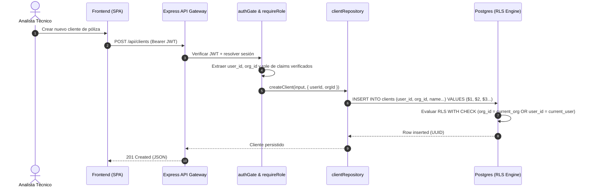

# Design: Entidad Real de Organizaciones y RLS a Nivel de Equipo

## Architectural Decisions

### Decision 1: Shared Database, Shared Schema con Discriminator Column (`org_id`)
- **Contexto:** Se evaluó si convenía separar por schemas en Postgres (`tenant_abc.clients`) o mantener un único schema `public` con `org_id`.
- **Decisión:** Mantener el schema compartido en `public` con `org_id UUID REFERENCES public.organizations(id)`.
- **Justificación:** Operar con Supabase Postgres y Railway hace que la creación dinámica de esquemas o bases de datos añada una sobrecarga inmanejable de migraciones y pool de conexiones (PgBouncer/Supavisor). Las políticas RLS con índices B-Tree en `(org_id, user_id)` ofrecen el mismo nivel de aislamiento con mínimo costo operativo.

### Decision 2: Funciones `SECURITY DEFINER` para Resolución de Membresía
- **Contexto:** Las subconsultas directas dentro de cláusulas RLS (`USING (org_id IN (SELECT org_id FROM organization_members...))`) provocan un escaneo repetido por fila y potenciales bloqueos de recursión si `organization_members` también tiene RLS.
- **Decisión:** Implementar funciones `SECURITY DEFINER` con `SET search_path = ''` (`is_org_member(lookup_org_id)` y `get_current_user_org_ids()`).
- **Justificación:** Se evalúan en un InitPlan único por consulta o usan índice directo, mejorando la velocidad de consulta entre 5x y 10x según las mejores prácticas de Supabase.

---

## Component Flow & Sequence Diagram



---

## Database Schema Structure

```sql
-- public.organizations
CREATE TABLE public.organizations (
    id UUID PRIMARY KEY DEFAULT gen_random_uuid(),
    name TEXT NOT NULL,
    nit TEXT UNIQUE,
    contact_email TEXT,
    phone TEXT,
    status TEXT NOT NULL DEFAULT 'ACTIVE',
    settings JSONB DEFAULT '{}'::jsonb,
    created_at TIMESTAMPTZ NOT NULL DEFAULT now(),
    updated_at TIMESTAMPTZ NOT NULL DEFAULT now()
);

-- public.organization_members
CREATE TABLE public.organization_members (
    id UUID PRIMARY KEY DEFAULT gen_random_uuid(),
    org_id UUID NOT NULL REFERENCES public.organizations(id) ON DELETE CASCADE,
    user_id TEXT NOT NULL,
    role TEXT NOT NULL CHECK (role IN ('super_admin', 'ally_admin', 'ally_technical')),
    created_at TIMESTAMPTZ NOT NULL DEFAULT now(),
    updated_at TIMESTAMPTZ NOT NULL DEFAULT now(),
    UNIQUE(org_id, user_id)
);
```

---

## Backward Compatibility & Fallback
Para no romper scripts ni tests existentes que solo pasen `user_id`, las políticas RLS emplean una condición disyuntiva:
```sql
USING (
  (org_id IS NOT NULL AND public.is_org_member(org_id))
  OR user_id = ((SELECT auth.uid())::text)
  OR user_id = (SELECT current_setting('app.current_user_id', true))
)
```
Si un registro antiguo no tiene `org_id` asignado, su creador original (`user_id`) sigue teniendo acceso garantizado.
